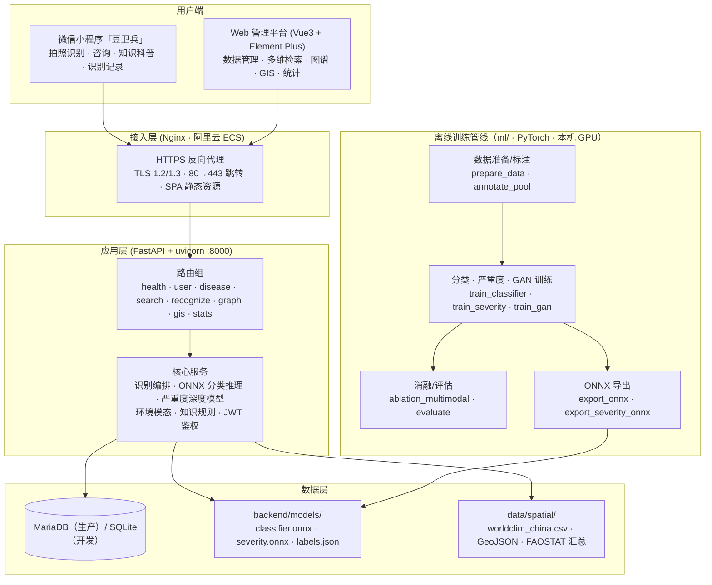
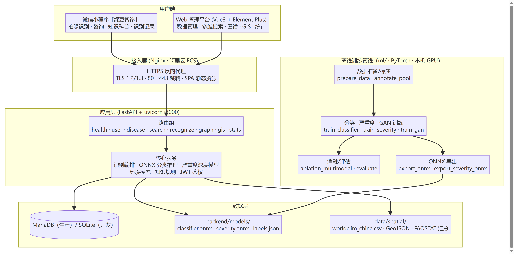
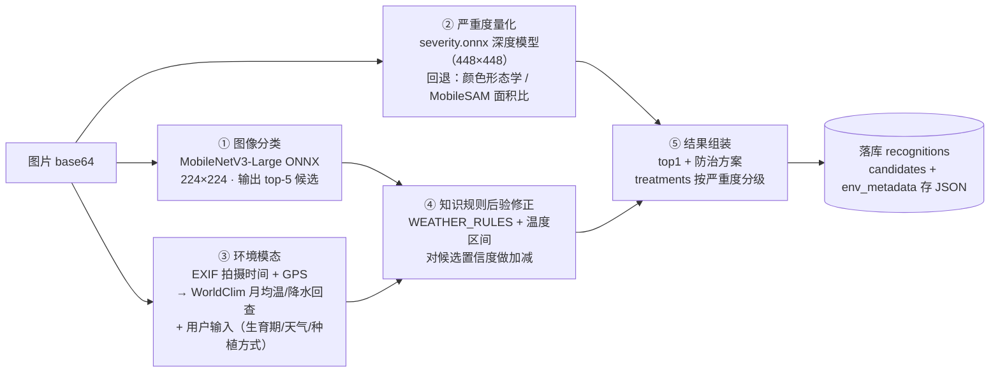
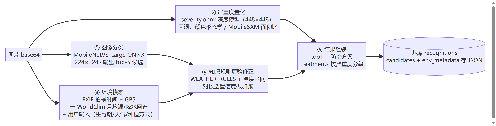
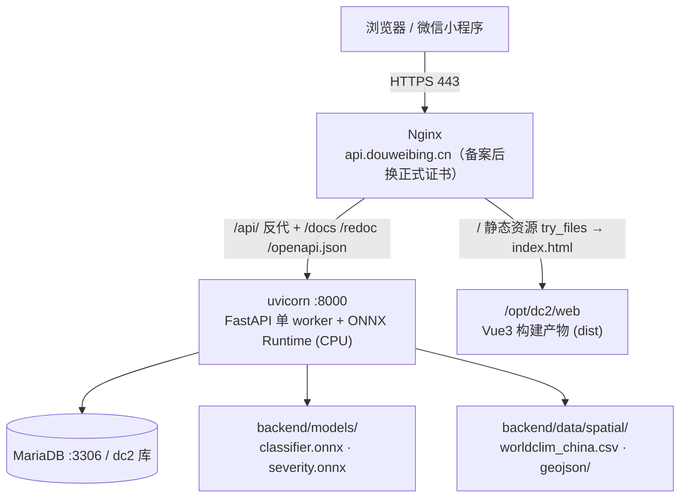
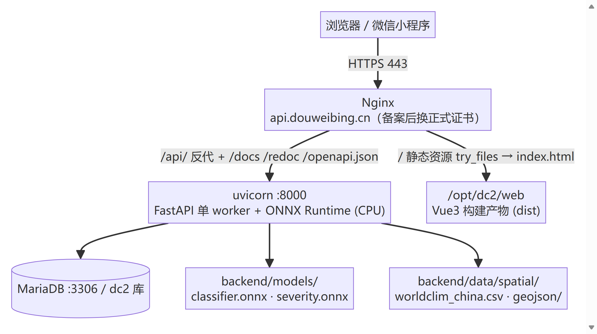
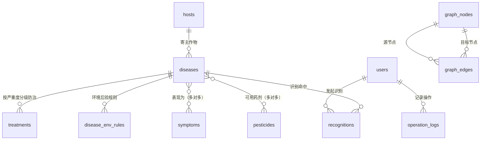
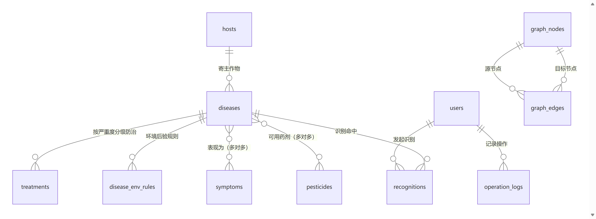

# 系统架构设计（豆卫兵）

> 回应 2026 计算机设计大赛评审意见第 4 条：文档里功能模块、数据库设计均未涉及。
> 本文全部内容与仓库代码一一对应，可对照 `backend/`、`web/`、`miniapp/`、`ml/`、`data/spatial/` 目录核实。
> 图用 Mermaid 绘制，Typora / VSCode（Mermaid 插件）/ GitHub 均可预览；提交材料时截图即可。

## 1. 总体架构

三层 + 一条离线训练管线：用户端 → 接入层 → 应用层 → 数据层；模型在本地训练、导出 ONNX 后部署到服务器 CPU 推理。

## 2. 图片识别链路（多模态融合）

识别是系统核心，链路与 `backend/app/services/recognize.py` 一致：图像分类 → 严重度量化 → 环境模态回查 → 知识规则后验修正 → 防治方案 → 落库。

三类模态说明（全部真实实现、无需传感器）：

| 模态 | 来源 | 实现位置 |
|---|---|---|
| 图像 | 叶片照片 → CNN 特征 | `services/model_inference.py` |
| 环境 | EXIF 时间/GPS + WorldClim 月均温降水回查 + 用户选填 | `services/env.py` |
| 知识 | 「病害—环境」规则先验，后验修正置信度 | `services/knowledge_rules.py` |

## 3. 部署架构（生产）

单台阿里云 ECS（华北2北京 · 2核4G · Ubuntu 24.04），`deploy/provision.sh` 一键部署。

关键部署点：
- 生效的 nginx 配置为软链 `sites-available/dc2-api.conf → /opt/dc2/deploy/nginx.conf`，升级只需更新该文件并 `systemctl reload nginx`。
- 后端以 systemd 服务 `dc2-api` 常驻，重启 `systemctl restart dc2-api`。
- 域名 `api.douweibing.cn` 已购并实名认证，ICP 备案通过后由 certbot 签发 Let's Encrypt 证书替换过渡用自签证书。

## 4. 数据库设计

14 张表（生产 MariaDB、开发 SQLite，`backend/app/models/*.py` 定义，`db.py` 自动建表）：

| 表 | 归属模块 | 作用 |
|---|---|---|
| `users` | 鉴权 | 用户，角色 admin / user |
| `operation_logs` | 鉴权 | 管理操作审计（病害/图谱写操作） |
| `hosts` | 病害知识 | 寄主作物（绿豆等） |
| `diseases` | 病害知识 | 病害条目（名/类型/病原/症状/发病条件） |
| `symptoms` | 病害知识 | 症状节点 |
| `disease_symptoms` | 病害知识 | 病害—症状多对多 |
| `treatments` | 病害知识 | 防治方案（病害 × 严重度 × 化学/农业/生物） |
| `pesticides` | 病害知识 | 药剂 |
| `pesticide_diseases` | 病害知识 | 药剂—病害多对多 |
| `disease_env_rules` | 多模态 | 环境条件下置信度修正量 |
| `recognitions` | 识别 | 识别记录（候选、严重度、环境上下文 JSON 全落库） |
| `graph_nodes` / `graph_edges` | 知识图谱 | 图谱三元组（双后端图引擎的 SQL 事实源；Neo4j 后端只读只算 + 尽力镜像，缺失自动回落） |
| `spatial_data` | GIS | 国家/省级产量、面积、风险区划汇总 |

## 5. 功能模块与代码映射

| 功能模块 | Web 前端 | 后端路由 | 核心服务 / 数据 |
|---|---|---|---|
| 登录鉴权 / 操作日志 | `web/src/views/Login.vue`、`Logs.vue`、`auth.js` | `routers/user.py` | `services/auth.py`、`users`、`operation_logs` |
| 图片识别（含严重度、多模态） | `web/src/views/Recognize.vue`；小程序 `pages/ai`、`pages/result` | `routers/recognize.py` | `services/recognize.py`、`model_inference.py`、`severity.py`、`severity_model.py`、`env.py`、`knowledge_rules.py` |
| 病害知识管理 | `web/src/views/Diseases.vue` | `routers/disease.py` | `models/disease.py` |
| 多维多条件检索 | `web/src/views/Search.vue` | `routers/search.py` | `models/disease.py` |
| 知识图谱可视化 | `web/src/views/Graph.vue` | `routers/graph.py` | `models/graph.py` |
| GIS / 种植分布 / 风险区划 | `web/src/views/Gis.vue` | `routers/gis.py` | `models/spatial.py`、`data/spatial/` |
| 统计可视化 | `web/src/views/Dashboard.vue`、`Stats.vue` | `routers/stats.py` | `recognitions` |
| 小程序薄端 | `miniapp/`（12 个页面，`utils/api.js` 走同一后端） | — | `config/env.js` 切换开发/生产地址 |

## 6. 离线训练与消融管线（ml/）

模型全部在本机 PyTorch 训练、导出 ONNX 后随发布包部署，真实指标入报告（`ml/experiments/*.json`）：

| 环节 | 脚本 | 产出 |
|---|---|---|
| 数据准备/标注 | `prepare_data.py`、`prepare_public.py`、`annotate_pool.py` | `ml/data/raw`（绿豆 10 类 601 张） |
| 分类训练 | `train_classifier.py` + `finetune_cv.py`（5 折） | 分类模型，5 折 CV pooled 0.8519 ± 0.022 |
| 严重度训练 | `train_severity.py`（179 张人工标注，mobilenetv3 骨干 + LR） | 5 折 CV 一致率 0.844 |
| GAN 数据增强 | `train_gan_v3.py`、`gan_quality.py` | 合成样本，A/B 消融入报告 |
| 多模态消融 | `ablation_multimodal.py` | 基线 0.8315 → 高温高湿环境模态 0.8427（+0.0112） |
| 评估/复现 | `evaluate.py`、`eval_repeat.py`、`eval_protocol.py` | 一致性、跨域、ONNX/Torch 对齐报告 |
| ONNX 导出 | `export_onnx.py`、`export_severity_onnx.py` | `backend/models/` 两个模型文件 |

> 说明：严重度生产主判定为深度模型（severity.onnx）；MobileSAM / 颜色形态学面积比因在用户主观图级标注上无法对齐，仅作模型缺失时的回退路径，论文中如实报告。
